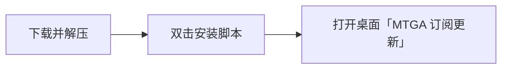
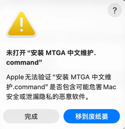
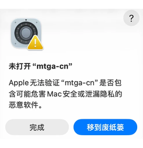
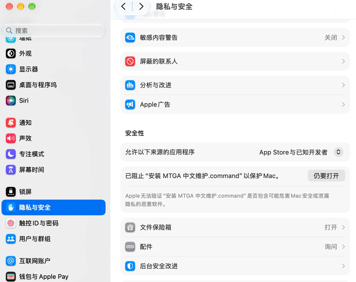
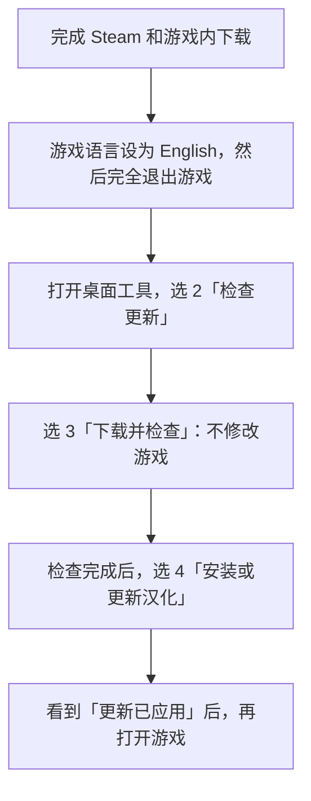
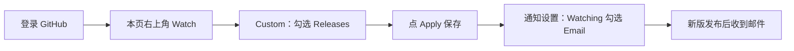

# MTGA 中文维护

macOS + Steam 版《万智牌：竞技场》汉化，支持中英文牌表导入，免费使用。

**[下载更新工具](https://github.com/1996Neil/mtga-chinese-updates/releases/download/client-v3.3-channel-fix/MTGA-Chinese-Subscriber-v3.3.zip)** · [版本记录](https://github.com/1996Neil/mtga-chinese-updates/releases) · [反馈问题](https://github.com/1996Neil/mtga-chinese-updates/issues/new)

适用于 **M 系列 Mac、macOS 13 及以上**。Windows 用户可查看[其他维护者的工具](https://shiqidi.lenitatis.com/mod)。

> [!IMPORTANT]
> **游戏内语言必须保持 English（英语）。安装或撤销汉化更新前，必须完全退出 MTGA。**

## 第一次安装工具

下载并解压 ZIP，双击「安装 MTGA 中文维护.command」。安装完成后，桌面会出现「MTGA 订阅更新.command」；已有同名入口会自动替换。

**安装完成后，ZIP 和解压出的安装包文件夹都可以删除。** 保留桌面入口，不要手动删除 `~/Library/Application Support/MTGAChineseSubscriber`，里面保存着工具和恢复备份。

### macOS 提示“未打开”怎么办？

确认文件来自本项目后，按下面操作。安装脚本和 `mtga-cn` 都可能各弹一次提示（图片可点击放大）：

<table>
<tr>
<td align="center"> 安装脚本的提示</td>
<td align="center"> 更新工具的提示</td>
</tr>
</table>

1. 点 **完成**，不要移到废纸篓。
2. 打开 **系统设置 → 隐私与安全性**，向下找到刚才被阻止的文件，点 **仍要打开**，按系统提示确认。
3. 重新双击「安装 MTGA 中文维护.command」。如果随后提示 `mtga-cn` 未打开，对它重复上述操作，再运行安装脚本。

不用更改上方“允许以下来源的应用程序”选项。若系统提示文件已损坏或会损害电脑，请保留提示到项目反馈。

## 安装汉化与以后更新

第一次装汉化和以后更新，都使用桌面入口，按下面顺序操作：

输入数字后按回车；操作结束后按回车返回菜单，**0** 退出。**游戏语言一直保持 English。**

- **下载失败：** 检查网络，再选 **3**。没有适配版本时，等待发布后再检查。
- **更新后有问题或安装中断：** 退出游戏，选 **5 撤销上次更新**。恢复到更新前的实际状态，不一定是官方原版；Steam 已更新游戏时，旧备份可能无法恢复。
- **想看当前安装情况：** 选 **1 查看当前汉化**。操作要点也可在菜单 **6 使用说明**里查看。

其他来源的旧汉化也可更新，工具会先备份。普通汉化修正**不需要重装工具**；只有提示需要升级工具时，才从本页重新下载安装，原配置和备份会保留。

## 邮件订阅

想在新版发布时收到邮件，先登录 GitHub，再按下面操作：

最后一步在 **头像 → Settings → Notifications → Watching → Email** 中设置。只点 Star 不会订阅邮件。

收到邮件后，打开桌面工具，依次选 **2 → 3 → 4** 更新汉化；邮件不会自动修改游戏。若发布说明要求升级工具，再从本页下载按钮获取新版安装包。

欢迎点 **Star** 支持维护。不订阅也能在桌面工具里主动检查更新。

## 参与维护

[构建与贡献](docs/DEVELOPMENT.md) · [维护规则与证据](docs/MAINTENANCE.md) · [汉化来源规范](tools/chinese-maintainer/SOURCE_LOOKUP.md) · [精简维护数据](maintenance-data/README.md) · [Agent 入口](AGENTS.md)

源码、更新工具和监控都在本仓库；译文来源和维护记录可复查。普通使用不用下载源码或维护数据。

游戏内 OCR 卡牌浮层已停止维护，代码可从 `git log -- tools/card-overlay` 查看和恢复。

社区项目，与 Wizards of the Coast 或 Steam 无关联。[源码许可与第三方内容说明](THIRD_PARTY_NOTICES.md)。
